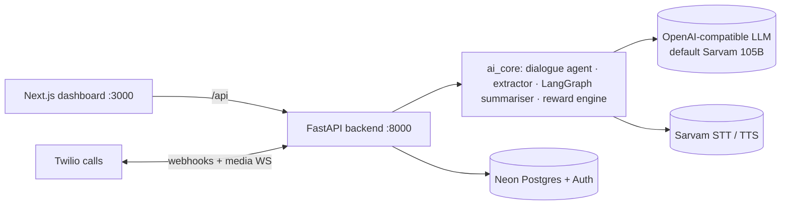

<div align="center">

<br/>

# 🔊 Conversely
### Configurable Voice Agents that Record & Document Every Conversation

*वाक् + सेतु — The Voice Bridge*

<br/>

[](https://python.org)
[](https://fastapi.tiangolo.com)
[](https://nextjs.org)
[](https://react.dev)
[](https://neon.com)
[](https://twilio.com)
[](https://docker.com)

<br/>

> **Conversely** is a business voice agent you tailor to your use case: a hotel receptionist, a hospital front desk, a customer-support line or a meeting note-taker. It holds or listens to the conversation in English, Indian languages or code-mixed speech, and documents it as a structured record plus a readable summary.

<br/>

---

</div>

## 📚 Docs

| File | What's in it |
|---|---|
| `README.md` | This page: what it is, how to run it |
| [`walkthrough.md`](walkthrough.md) | Guided code tour: each request flow, file by file, plus how to change things and debug |
| [`plan.md`](plan.md) | Architecture, context, data model, known limitations, and the roadmap (target platform, task graph, mobile app) |

---

## 💡 What Conversely Does

- 🧠 **Runs configurable dialogue agents.** Build an agent in the UI (fields to collect, prompt, greeting, escalation triggers); it converses in Hindi, English or code-mixed speech and fills the fields as it goes.
- 🎙️ **Listens and transcribes** with Sarvam STT, and **speaks** with Sarvam TTS.
- 👂 **Observes live conversations and phone calls** (browser mic or Twilio) and builds a running narrative plus a structured record.
- 🤖 **Scores every session**: programmatic metrics plus an LLM judge, with a DPO `chosen`/`rejected` label.
- 🖥️ **Dashboard** at `/analysis`: CRUD for agents and sessions, per-session stats, and PDF export.

---

## 🏢 Use Cases

One product, configured per deployment. You don't need new code for a new industry:

| Where | What the agent does |
|---|---|
| Hotel front desk | Greets guests, captures bookings and requests, logs every interaction |
| Hospital / clinic reception | Registers visitors, routes them to departments, escalates emergencies |
| Customer support & sales calls | Talks to customers, records issues, commitments and next steps |
| Meetings & consultations | Listens, then produces a summary, decisions and action items |

---

## 🏗️ Architecture



Details are in [`plan.md`](plan.md) §2.

---

## 🚀 Quick Start

**Prerequisites:**
- Python 3.10+ (3.13+ works; `audioop-lts` is pulled in automatically)
- Node.js 18+
- ffmpeg on `PATH`, or unpacked into `tools/ffmpeg/`
- Docker, only for the Twilio ngrok tunnel

```bash
cp .env.example .env                                # fill SARVAM_API_KEY and LLM_API_KEY

python -m venv venv
venv\Scripts\activate                               # Linux/macOS: source venv/bin/activate
pip install -r requirements.txt
python -m uvicorn backend.main:app --port 8000 --reload

cd frontend && npm install && npm run dev           # http://localhost:3000
```

**Check it's working:**
- `http://localhost:8000/health` should respond.
- The API docs are at `http://localhost:8000/docs`.
- The live-capture page is at `http://localhost:8000/live`.
- `python -m pytest -q` runs the offline tests; no API keys are needed.

**Twilio calls (optional):** run `docker compose up -d`, copy the ngrok https URL into `PUBLIC_BASE_URL`, then call `POST /api/calls/outbound`.

---

## 📁 Project Structure

```text
Conversely/
├── backend/            # FastAPI app: routes/, auth (Neon JWT), Postgres/SQLite layer, /live page
├── ai_core/            # LLM factory, dialogue agent, extractor, LangGraph summariser, ASR, TTS, reward engine
├── frontend/           # Next.js dashboard + sign-in (Neon Auth)
├── mobile/             # Flutter recorder app (scaffold, see plan.md §4)
├── tests/              # Offline API + auth tests
├── requirements.txt    # Backend dependencies
├── Dockerfile          # Backend image (Render)
├── docker-compose.yml  # ngrok tunnel for Twilio
├── plan.md             # Architecture + roadmap
└── walkthrough.md      # Code walkthrough
```

---

## 🔑 Environment Variables

From `.env.example`:

```env
# ── Sarvam AI (ASR + TTS) ────────────────────────────────────────
SARVAM_API_KEY=

# ── Chat LLM (dialogue agent, extraction, summaries, reward judge) ──
# Any OpenAI-compatible endpoint.
LLM_PROVIDER=openai
LLM_BASE_URL=https://api.sarvam.ai/v1
LLM_MODEL=sarvam-105b-conversations
LLM_API_KEY=

# ── Twilio (outbound calls, optional) ────────────────────────────
TWILIO_ACCOUNT_SID=
TWILIO_AUTH_TOKEN=
TWILIO_PHONE_NUMBER=
# Public URL Twilio can reach (ngrok: check http://localhost:4040 after docker compose up)
PUBLIC_BASE_URL=
NGROK_AUTHTOKEN=

# ── HuggingFace (only for the optional IndicWhisper ASR fallback) ──
HF_TOKEN=
```

| Key | Where to get it |
|---|---|
| `SARVAM_API_KEY` | https://dashboard.sarvam.ai |
| `LLM_API_KEY` | Your OpenAI-compatible provider. Default is Sarvam, so this is your Sarvam key. |
| `TWILIO_*` | https://console.twilio.com |
| `HF_TOKEN` | https://huggingface.co/settings/tokens (optional IndicWhisper fallback only) |

---


**Conversely** — *Bridging Languages, Automating Workflows*


<br/>

</div>
